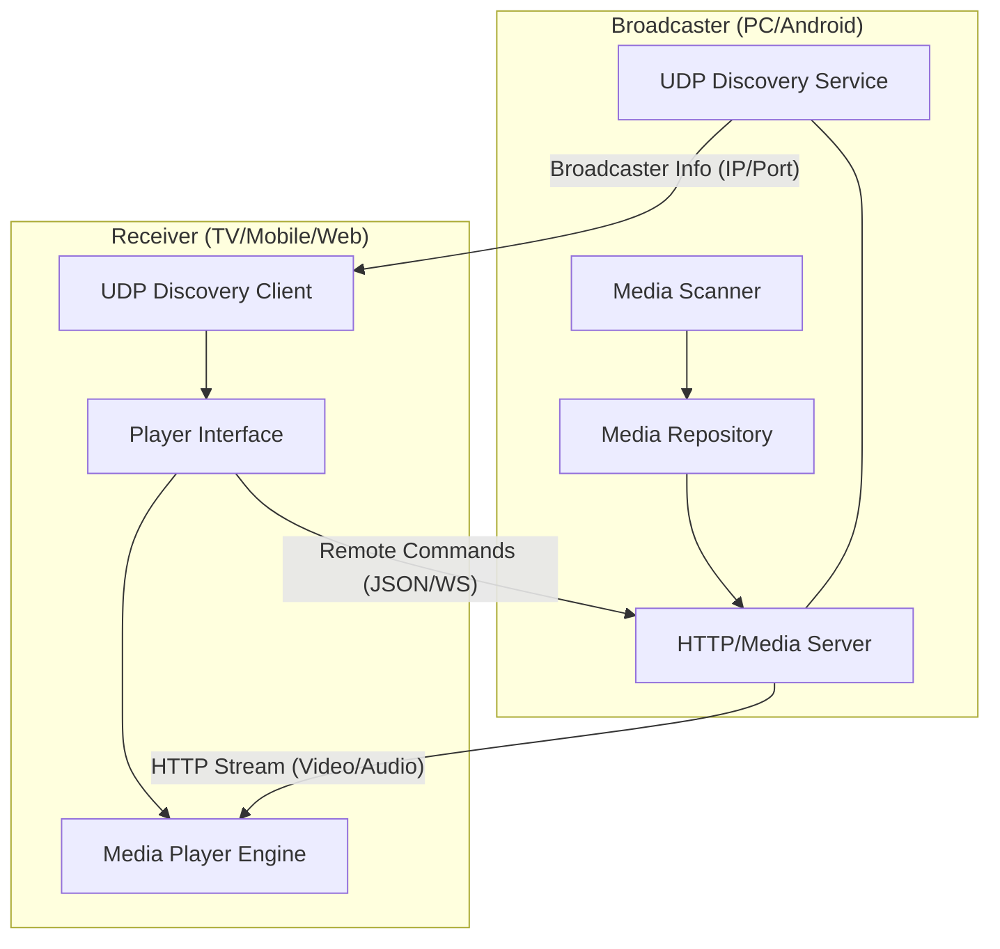

# 02 Technical Architecture Document (TAD) — STREAMZ

## 1. High-Level System Architecture
STREAMZ is built as a decentralized, peer-to-peer (P2P) local streaming system. Every instance of the application contains both the **Server (Broadcaster)** and **Client (Receiver)** logic, enabling any device to act as a source or a sink for media.

### 1.1. Conceptual Diagram


---

## 2. Technology Stack
- **Frontend Framework:** Flutter (Multi-platform: Windows, Android, Android TV, Web)
- **State Management:** Provider (Pragmatic, high-performance for reactive UI)
- **Dependency Injection:** GetIt (Service Locator pattern for clean separation)
- **Media Engine:** `media_kit` (FFmpeg-based, hardware-accelerated playback)
- **Network Layer:**
    - **Discovery:** UDP Multicast/Broadcast for zero-config networking.
    - **Streaming:** Shelf (Dart HTTP Server) for serving files and API endpoints.
    - **Communication:** Standard HTTP for metadata and commands.
- **Storage:**
    - **Local State:** Shared Preferences / Hive for settings and watch progress.
    - **Media Metadata:** In-memory caching with persistent file-system scanning.

---

## 3. Core Components

### 3.1. Media Engine (Domain Layer)
- **`MediaScanner`:** Recursively scans selected directories for supported file types (MP4, MKV, MOV, etc.).
- **`MediaRepository`:** Central source of truth for all local and discovered remote media.

### 3.2. Networking (Data Layer)
- **`UDPServer`:** Periodically broadcasts the device's presence (Name, Role, Port) on the local network.
- **`HTTPMediaServer`:** A lightweight web server that handles range-requests (CRITICAL for video seeking) and serves JSON metadata.

### 3.3. Remote Command Protocol
A lightweight JSON-over-HTTP protocol for controlling remote instances:
```json
{
  "command": "play_pause",
  "payload": { "state": "playing" },
  "origin": "Remote_Phone_1"
}
```

---

## 4. Design Philosophy
- **Stateless Communication:** The Broadcaster remains mostly stateless regarding which clients are connected, serving files on demand to maximize performance.
- **Service Locator Pattern:** All core services (`NetworkService`, `PlayerService`, `ThemeService`) are registered at startup via `GetIt` to ensure easy mocking for tests and clean decoupled logic.

---

## 5. Performance & Resource Management
- **Isolate-based Scanning:** Media scanning runs in a separate Dart Isolate to prevent UI jank.
- **WakeLock:** Broadcasters maintain a WakeLock to prevent the OS from killing the server during active playback.
- **Thumbnail Optimization:** Video thumbnails are generated on-demand and cached to minimize disk I/O and memory footprint.

---

**Approval Status:** Pending Review
