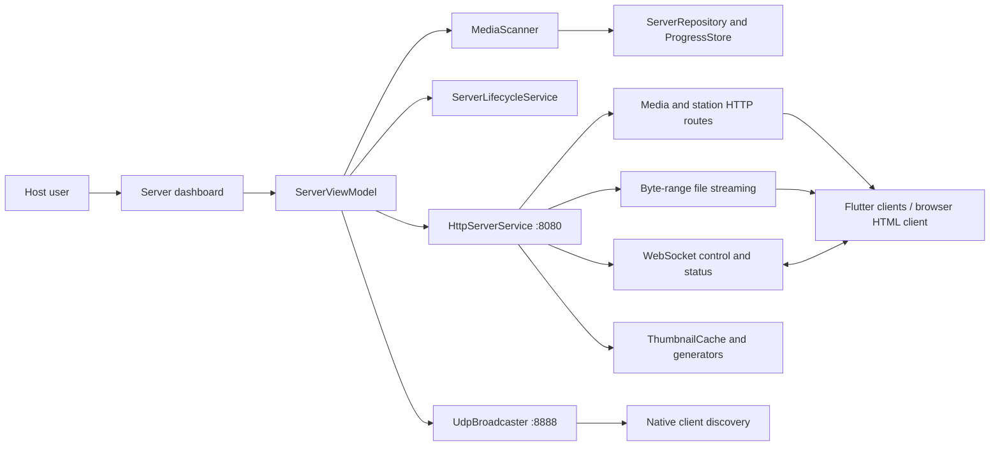
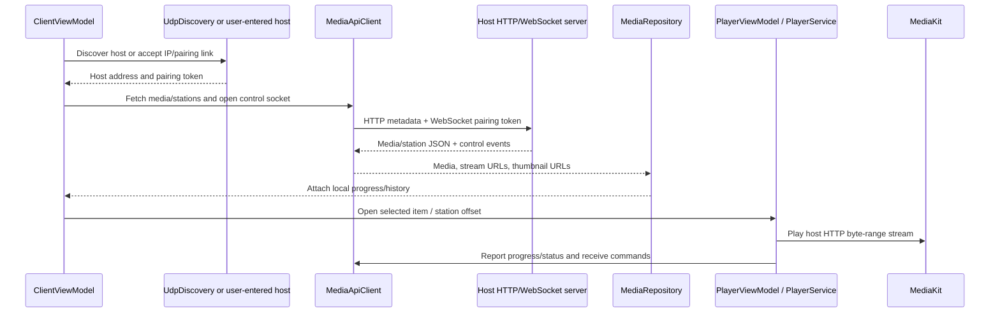

# STREAMZ Architecture and Platform Notes

This document records the architecture visible in the current source tree. It describes implemented flows and known constraints; a target listed here still needs release-build and hardware verification before it can be called fully supported.

## System boundary

STREAMZ has two related client paths and a native host:

1. A native Flutter app on Android or Windows can scan configured local media and run the LAN host.
2. Native Flutter clients connect to a host using the Flutter UI and MediaKit player.
3. A normal browser can open the HTML/JavaScript client served by a native host. This is distinct from compiling the Flutter app for Web.

The Flutter Web build is a browser client target. Web media scanning is disabled, UDP discovery is a no-op, and the current browser runtime is not a native media server. The app's browser playback is subject to browser codecs and autoplay/fullscreen policies.

## Layer map

| Layer | Main responsibilities | Representative paths |
| --- | --- | --- |
| Presentation | Navigation, responsive/mobile/TV screens, player controls, and ChangeNotifier ViewModels | `lib/presentation/`, `lib/core/navigation/app_router.dart` |
| Domain | Media/station/session models and playback, discovery, lifecycle, queue, and remote-control services | `lib/domain/models/`, `lib/domain/services/` |
| Data | Local scanning, progress/history persistence, thumbnail cache, HTTP client, and server/client repositories | `lib/data/local/`, `lib/data/network/`, `lib/data/repositories/` |
| Composition and shared UI | GetIt service registration, Provider exposure, design tokens, themes, and common focus helpers | `lib/core/di/service_locator.dart`, `lib/main.dart`, `lib/core/theme/` |
| Platform shells | Android activity/manifest/resources, Windows runner, and Flutter Web bootstrap | `android/`, `windows/`, `web/` |

GetIt registers shared infrastructure, repositories, domain services, and the main client/server ViewModels. `main()` initializes Flutter, MediaKit, the Windows window manager when running on Windows, shared preferences, the thumbnail cache, and the service locator; it detects Android TV and exposes shared ViewModels through Provider. GoRouter builds the role, client, server, mobile, TV, and player routes.

## Flutter UI composition

`MaterialApp.router` is built from the active `ThemeService` appearance settings. Its root builder layers `AppBackdrop`, the launch overlay, and `TVDeviceScope` around the stable GoRouter child. Routed screens use `AppScaffold` and the shared app-bar, card, action-grid, list-row, sheet, and state primitives. `AppTextStyles`, `StreamzThemeExtension`, and `DS` provide typography, colors, spacing, breakpoints, and corner geometry; `DS.responsiveColumns` keeps action and media grids aligned with both viewport width and text scale.

Appearance preferences are stored locally through `ThemeService`: font family, title weight, scaffold glow color, and corner radius update the shared theme. Screens keep navigation, data requests, and mutations in their existing ViewModels and services; shared widgets receive display data and callbacks.

## Host data flow

1. `ServerViewModel` loads saved settings and shared folders, scans Android media providers where available, then recursively scans configured folders on native platforms.
2. It composes media items with saved progress/history, sets station state and the pairing token, starts `HttpServerService` on port `8080`, and starts UDP announcements/discovery support on port `8888`.
3. Shelf routes expose the browser UI, media/station metadata, folder browse, file access, thumbnails, and `/stream/<id>`. `_serveFile` streams from disk and honors HTTP byte ranges so players can seek without loading an entire file into memory.
4. The server also accepts WebSocket clients. It tracks sessions and connected clients, relays remote playback/control events, and maintains queue/station state.
5. Android lifecycle handling can request a wake lock and background execution for a running host. Windows and Web do not use the Android background service.

## Native Flutter client data flow

The UI/ViewModel owns playback intent and synchronization; `PlayerService` owns the MediaKit player, playlist, progress reporting, station drift correction, remote commands, and session status. The host does not transcode the file: it serves source bytes and the client device decodes them.

`PlayerViewModel` observes MediaKit error, buffering, playing, and position streams. For remote connection failures it retains the current position, reopens the current stream, and retries with 2/4/8/16/30-second backoff that stays capped at 30 seconds until playback recovers or the user pauses/leaves. It classifies connection, codec, device/browser, and unknown failures to show a retry/back-to-library overlay. Classification is best-effort because native and browser player errors are not represented by one structured API.

On player disposal, `PlayerService` saves the latest position before `ClientViewModel` refreshes its in-memory media list from the local progress store. Continue Watching and its progress indicator therefore reflect the last session when the user returns to the library without requiring a server refetch.

## Browser client flow

The native host returns an HTML/JavaScript media browser from `/`. The page requests JSON endpoints, loads thumbnails and source media over HTTP, and uses the browser's `<video>`/`<audio>` support. It connects to the same WebSocket endpoint for session/control features. `web_html.dart` and `modern_web_html.dart` contain parallel browser-client implementations selected by host settings. Both now surface browser media/network errors, retry interrupted streams with capped backoff, and restore the last browser playback position. Their JavaScript and browser playback flows remain separate, so behavior changes still need parity checks in both.

The Flutter Web target is separate: it runs Flutter UI in a browser and uses MediaKit's web behavior, which ultimately depends on browser media support. It cannot scan local native folders through the current `MediaScanner`, and `UdpDiscovery.start` returns immediately on Web. Use manual host entry where the UI flow allows it. Do not treat a successful Web compile as proof that native host/server functions work in a browser.

## Platform capability matrix

| Capability | Android phone/tablet | Android TV | Windows | Flutter Web | Host-served browser |
| --- | --- | --- | --- | --- | --- |
| Local host and HTTP streaming | Implemented in native code | Same Android app/host path | Implemented in native code | Not a supported hosting path | No; browser is a client |
| Local media scan | Android media providers and configured folders, subject to permissions | Same Android behavior, subject to device storage/permissions | Configured folders | Disabled | No local disk scan |
| Native UDP discovery | Yes, subject to LAN/router rules | Same Android behavior | Yes, subject to firewall/network | Disabled | No; enter/use host URL |
| Flutter UI playback | MediaKit native backend | MediaKit native backend | MediaKit native backend | Browser-dependent MediaKit backend | Browser `<video>`/`<audio>` |
| Remote/D-pad interaction | Touch and supported keyboard input | Leanback detection, focus-aware UI, D-pad/Select shortcuts | Keyboard/mouse | Browser keyboard/mouse/touch | DOM focus and browser key events |
| Codec/resolution guarantee | None; decoder and device dependent | None; decoder, display mode, and device dependent | None; backend and hardware dependent | Browser codec support dependent | Browser codec support dependent |

Android TV is an Android package configuration: `AndroidManifest.xml` declares `LEANBACK_LAUNCHER`, the TV banner, and optional touchscreen; `PlatformService` detects Leanback/television system features; `main.dart` supplies a TV device scope and activation shortcuts. Layout decisions also use Flutter logical viewport breakpoints (`600`, `900`, `1200`, and `1600` logical pixels in the design tokens). The diagonal size in inches is not a reliable layout input.

HD or 4K output is not a package-level guarantee. A 4K TV can still report a different logical size/density; overscan and viewing distance matter; the source may be lower resolution; network throughput can bottleneck; and the decoder may not support a codec/profile. Validate on representative TVs, including 720p/1080p and 4K output modes, rather than infer behavior from the panel's inch rating.

## Architecture assessment

These are the main risks to consider before changing code. They are observations, not proof of a user-visible defect.

| Area | Current condition | Risk and safe direction |
| --- | --- | --- |
| HTTP trust boundary | Pairing is checked when the WebSocket control endpoint is negotiated. HTTP metadata, file, thumbnail, and stream routes do not use that WebSocket check; transport is cleartext. | Anyone who can reach the host can request shared media over HTTP. Keep the server on a trusted LAN; future authentication/TLS changes need an explicit compatibility and threat-model review. |
| Scanner scale | Recursive directory scanning collects all matching paths before converting results; the library and some state are held in memory. | Very large libraries or deep/slow disks can increase startup time and memory. Measure representative libraries, then consider incremental enumeration and paginated metadata without changing IDs/order semantics. |
| Server responsibility concentration | `HttpServerService` owns route setup, file/range serving, thumbnail resolution, WebSocket lifecycle, pairing, station joins, session updates, and relay logic. | Changes are harder to test independently. Extract only after route behavior and the existing security tests are characterized. |
| Browser implementation duplication | Two large generated HTML clients carry similar markup, media controls, and WebSocket logic; their premium CSS has been aligned, but the JavaScript remains separate. | Functional fixes can drift even while visuals match. Compare behavior and consolidate only after both variants' browser flows are covered. |
| Global state and composition | GetIt singletons plus global locator access in some ViewModels make lifecycle and dependencies less visible. | Tests and alternate app instances can be coupled. Prefer constructor dependencies where a concrete change benefits testability; avoid a broad DI rewrite. |
| Platform parity | Native scanning, discovery, lifecycle, and media decoding differ by target; Web's browser decoder is not equivalent to native MPV. | A shared UI does not imply identical capabilities. Maintain a capability matrix and test the target-specific flow rather than masking unsupported paths. |
| Release configuration | Android Gradle still uses the example application ID `com.example.streamz` and debug signing for release builds. | Store distribution requires a production ID and signing configuration; do this as a release task, not as part of a behavior-preserving refactor. |
| Dependency build reliability | A previous Android build attempt timed out while downloading a MediaKit MPV artifact. | This is a dependency-fetch/build infrastructure failure until runtime playback is separately shown to fail. Keep artifacts cached or use reliable CI networking; evaluate any player replacement against feature parity and build behavior. |

## Refactoring strategy

1. Establish a platform behavior baseline for host start/stop, discovery/manual connect, browse/stream/seek, thumbnails, stations, remote control, and reconnect/error states.
2. Keep MediaKit while it meets the current native playback needs. If evaluating another backend, do it as a narrow spike and compare audio/subtitle track selection, screenshots/thumbnails, seeking, supported formats, Android TV input, and build artifacts.
3. Reduce the largest measured bottlenecks first: large-library scan latency/memory, browser HTML drift, or WebSocket fan-out. Add pagination/batching only with stable API compatibility and coverage.
4. Split `HttpServerService` by cohesive responsibility only when changes or tests need that boundary. Preserve endpoint names, status codes, range semantics, and pairing behavior.
5. Keep mobile/TV/desktop UI variants where interaction models differ; reuse shared tokens, `DS.responsiveColumns`, and focus-aware primitives where behavior matches. Avoid rewrites that change focus or navigation behavior.
6. Treat Android release ID/signing and LAN security design as explicit release work. Do not claim production security while media endpoints are unauthenticated and cleartext.

## Cross-platform verification checklist

| Flow | Android phone | Android TV / remote | Windows | Flutter Web | Host-served browser |
| --- | --- | --- | --- | --- | --- |
| Connect: discovery and manual IP | Verify both | Verify discovery and manual IP with remote | Verify both | Verify manual entry; discovery is unavailable | Open host URL / pairing link |
| Library scan and browse | Check permissions and large folder | Check external/removable storage behavior | Check configured folders and access errors | Confirm no local scan; connect as client | Browse host library |
| Play, pause, seek, next/previous | Representative codecs | D-pad, Select, back, focus and overscan | Keyboard/mouse and representative codecs | Browser codecs/autoplay restrictions | Browser codecs/fullscreen restrictions |
| Stations and remote control | Multi-client sync | Remote-only entry/control | Multi-client sync | Client behavior where UI supports it | WS control/session behavior |
| Responsive layouts | Small and large logical widths | HD/1080p and 4K modes, focus visibility | Resize narrow through ultrawide | Browser resize and text scaling | Browser resize and keyboard focus |
| Recovery | Permission denial, host loss, reconnect | Host loss using only remote | Firewall/host loss/reconnect | Refresh/disconnect/manual reconnect | WS loss, media error, retry |

Run builds on the matching operating systems. A Windows release build cannot be validated by the presence of `windows/` on a non-Windows host, and a Web compile does not validate browser codec behavior or Android TV input. Record which physical devices, OS versions, display modes, and sample media files were used for any compatibility claim.
